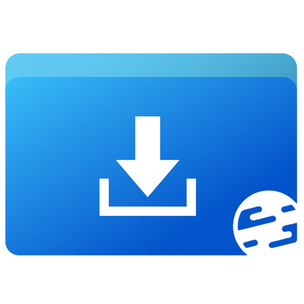

# ClassSoftwareHub · 桌面版

**电教委员常用软件下载站 · 桌面客户端**

面向班级电教委员的桌面客户端。软件清单与站点同步，浏览、检索、下载都在本机完成；课堂工具与系统工具随程序安装在本地，不依赖网络。

- 网站：[电教委员常用软件下载站](https://classsoftwarehub.us.ci/#/home)
- 网页版源码：[c1201y/ClassSoftwareHub](https://github.com/c1201y/ClassSoftwareHub)
- Windows 7 移植版：[c1201y/ClassSoftwareHub-windows7](https://github.com/c1201y/ClassSoftwareHub-windows7)

## 功能

### 软件下载

- **分类与检索**：按分类浏览软件清单，或直接输入名称检索；列表显示名称与简介。
- **软件详情**：展示简介、版本号、体积、系统要求与开发者信息，并提供多个下载来源，可按网络情况切换。
- **下载与安装**：下载完成后可直接安装或解压，也可保留安装包备用；下载与清理进度统一在「任务进行」页查看，离开页面不会中断。
- **提交软件**：填写软件名称、简介、下载地址、开发者与开源协议后提交，审核通过后进入清单。

### 课堂工具

- **随机抽号**：按学号范围或班级名单抽取，支持一次抽多个、抽过不重复与随机分组。
- **课堂计时器**：倒计时与秒表两种形态，大字号便于投影，到达设定时间响铃。
- **全屏时钟**：将屏幕变为大型时钟，可设置背景图与蒙版。
- **函数图像**：支持显函数、隐函数、不等式、极坐标与参数方程，可作点、线段、圆、椭圆、双曲线与多边形，并能绘制平行线、垂线与切线。
- **方程求解**：一次方程组给出精确分数解，一元方程支持平方、三角函数、对数与指数。
- **化学方程式配平**：输入 A + B = C 形式的方程式，算出最小正整数系数，并逐种元素核对左右原子数。
- **教室喊话**：向同一配对码的设备发送一条通知，显示 180 秒后自动消失，接收方无需额外安装组件。

### 系统工具

- **磁盘空间**：按占用面积画出目录结构，单击方块逐层下钻，定位占用较大的目录。
- **系统修复**：系统文件、组件存储、网络栈与系统服务的修复命令，按预设卡片执行，执行前原样列出命令。
- **系统优化**：任务栏、资源管理器等整机设置，选中后一次授权统一应用。
- **系统功能**：休眠、快速启动、电源计划等系统开关，排队后一次授权写入。
- **虚拟内存**：逐个驱动器设置分页文件大小，重启后生效。
- **幽灵文件清理**：清理删不掉、双击提示找不到路径的残留条目。
- **图片取色**：导入图片后提取一组柔和配色，单击色块复制色值。
- **编码与哈希**：拖入文件即得 MD5、SHA-1、SHA-256 与 SHA-512，可粘贴官方校验值自动核对，也支持 Base64 与 URL 编解码。
- **自动关机**：按星期设定关机时间点，支持直接关机、延迟关机与系统原生的滑动关机。
- **白板专杀**：到点结束希沃白板5 后台滞留的残留进程，只认白板家族，不碰集控端与更新组件。
- **AppData 管理**：列出 AppData 下可安全清理的缓存目录，按占用排序，逐个确认后删除。
- **PowerPoint 触控优化**：放映时轻点屏幕翻到下一页，上下滑动切换页面，长按弹出放映菜单。

### 内容与助手

- **文档库**：收录电脑优化与使用技巧的图文教程，按标题、简介与标签检索，文章随仓库更新，不必等待版本发布。
- **查阅单词**：内置约三万条常用词，未收录的词转在线词典查询，支持英汉互译与整句翻译，另有快速查词浮窗。
- **Hub AI**：内置助手，可就本机情况与程序功能提问，回答末尾给出可直接点击的入口。需先在「设置 → Hub AI」中配置模型服务。

### 界面与操作

- **工具侧边栏**：可贴靠屏幕任意一条边。展开后即可使用常用系统操作与常用入口两类模块，前者包括音量、屏幕亮度、截屏贴图、放大镜、任务管理器、安全选项、剪贴板历史、任务视图、回到桌面、关闭前台或全部窗口与关机，后者包括文件资源管理器、运行、屏幕键盘、锁定电脑与 PowerPoint 触控。模块清单与排列顺序可在「侧边布局」页调整。
- **截屏贴图**：框选区域后在编辑窗中标注，支持画笔、荧光笔、箭头、矩形、椭圆、文字与马赛克，可撤销重做、复制、保存与钉图。
- **全站搜索**：按 Ctrl + K 检索软件、内置工具与页面。
- **导航与侧边布局**：常用页面放在一级，其余收进所属分组；新增入口标注 New 或 Beta，显示三天后自动消失。
- **初次配置**：首次安装后进入分步向导，外观、下载位置、常用功能与模型服务在向导内一次选定。
- **更新日志**：在应用内查看各版本的更新内容，可只看正式版本或查看全部。
- **实验性功能**：收录稳定性与准确度仍在观察的功能，页面标题旁标注实验性标记。当前四项：本机核实（对照清单查看已安装与缺少的软件）、程序专杀（按时间点清理指定进程）、应用卸载（调用程序自带的卸载程序）、开机启动项（查看与禁用启动项）。
- **设置**：颜色模式、窗口背景效果、窗口置顶、开机自启、关闭时收进托盘、更新通道、下载位置，以及缓存与日志的清理。

## 安装

1. 从 [Releases](../../releases) 下载最新的 `ClassSoftwareHub-Setup-dv*.exe`。
2. 双击运行，按向导完成安装。程序默认安装于当前用户目录，无需管理员权限，安装过程中可指定其他位置。
3. 安装完成后，桌面与开始菜单会生成快捷方式。

本程序为自包含发布，无需另行安装运行库。设置与内容缓存存放于 `%LOCALAPPDATA%\ClassSoftwareHub`，与程序目录相互独立，卸载程序不会删除该目录。

## 系统要求

Windows 10 1809（Build 17763）或更高版本，64 位。Windows 8.1 及更早的系统请使用 [Windows 7 移植版](https://github.com/c1201y/ClassSoftwareHub-windows7)。

WebView2 运行时为可选组件。全部界面均为原生实现，仅在应用内显示网页时会用到，例如从软件详情页打开官网。缺少该组件不影响主要功能，相关位置会提供安装指引与用浏览器打开的替代方式，安装向导在检测到缺失时也会询问是否自动安装。

## 更新

程序会自行检查新版本，并提供两条更新通道：

- **稳定通道**：仅接收正式发布的版本。
- **Insider 通道**：新功能先在预览通道提供，稳定性略低于正式版本。

更新不会强制进行。检测到新版本时先行询问，可选择立即更新或稍后处理；选择稍后时，下次启动仍会再次提示。需要回退时，可在「设置 → 更新」中从本地保留的安装包中装回较早的版本。

## 反馈

遇到问题可在 [Issues](../../issues) 提交，说明系统版本与复现步骤即可。功能建议与使用问题也可以提交到同一处。

自行编译与发版流程见 [BUILDING.md](BUILDING.md)。

## 其他内容

* 网站链接：[电教委员常用软件下载站](https://classsoftwarehub.us.ci/#/home)
* 投喂作者：[爱发电 · 连接创作者与粉丝的会员制平台](https://ifdian.net/a/TinyNickCSHub)
* Github 主页：[c1201y/ClassSoftwareHub-Desktop](https://github.com/c1201y/ClassSoftwareHub-Desktop)
* Github 更新文章：[Releases · c1201y/ClassSoftwareHub-Desktop](https://github.com/c1201y/ClassSoftwareHub-Desktop/releases)
* 此项目由人类构建。
