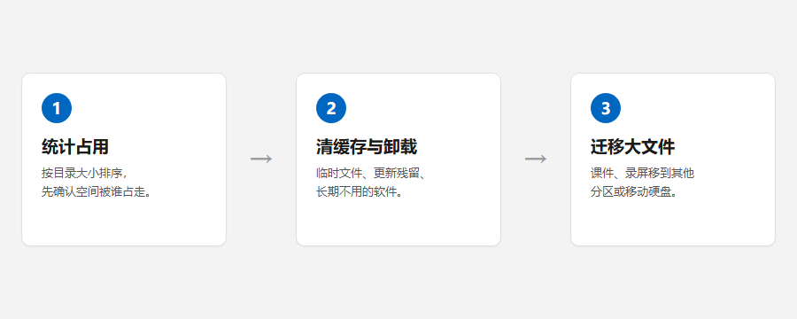

# C 盘空间不足时的清理顺序

教室电脑的 C 盘通常只有一百来 GB，装完教学软件与素材之后，剩余空间很快见底。清理时先确认空间被谁占用，再从可回退的位置开始动手。

## 一、先统计占用

打开[磁盘空间](csh://tool/disk-map)，选择 C 盘扫描。结果按目录大小排序，前几项通常就是占用大头。

常见的占用来源：

- `Windows\Installer`：安装包缓存，删除后无法修复或卸载对应软件；
- `Windows\WinSxS`：组件存储，由系统管理，不做手工删除；
- 用户目录下的 `Downloads`、`Desktop`：教学素材与课件；
- 各软件的缓存目录：视频缓存、浏览器缓存。

## 二、从可回退的位置开始清

系统自带的清理入口优先：[存储设置](ms-settings:storagesense) 可以清掉临时文件与更新残留；需要卸载软件时，使用[应用卸载](csh://page/uninstaller)。

> 清缓存之前先确认软件处于关闭状态。文件被占用时，清理往往只删掉一部分。

## 三、缓存与素材迁移

空间仍然紧张时，把课件、录屏这类大文件移到其他分区或移动硬盘。迁移完成后核对原目录，确认没有残留的快捷方式。

## 四、清理之后

回到[磁盘空间](csh://tool/disk-map)重新扫描，确认释放量。与预期差距很大时，多半是系统还原点或休眠文件占位，可以在[系统功能](csh://page/sysfeatures)里查看休眠文件大小。

相关阅读：[开学前教室电脑检查清单](csh://article/classroom-pc-checklist)
